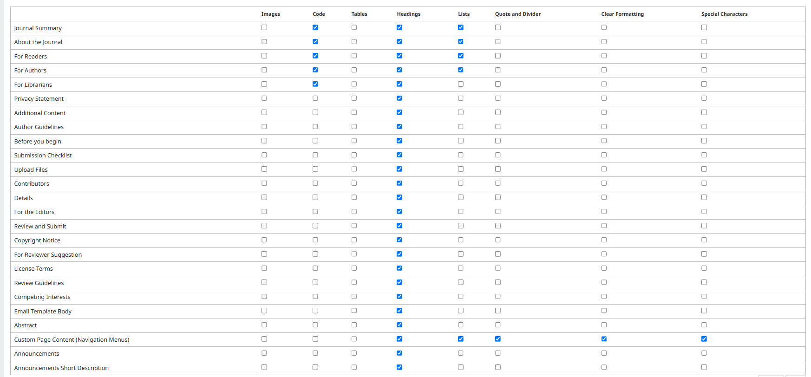

# Text Editor Extras Plugin

An [OJS](https://github.com/pkp/ojs) plugin to add controls to the rich text editor to upload images, manipulate the HTML code, add tables, headings, lists and other formatting.



## Compatibility
* OJS 3.5.x

## Installation

You can install this plugin from the plugin gallery in OJS after upgrading to v3.5.x

## Usage

Please read the guidance provided in the plugin's settings area to ensure you're use of these extra controls does not create problems for the distribution of your journal material.

### Available controls

| Control | Toolbar buttons | HTML tags produced |
| --- | --- | --- |
| Images | `image` | `img` |
| Code | `code` | – |
| Tables | `table` and related | `table`, `tbody`, `tr`, `td` |
| Headings | `blocks` (Paragraph, H2–H6) | `h2`–`h6` |
| Lists | `bullist`, `numlist` | `ul`, `ol`, `li` |
| Quote and Divider | `blockquote`, `hr` | `blockquote`, `hr` |
| Clear Formatting | `removeformat` | – |
| Special Characters | `charmap` | – |

H1 is not offered because the page template already provides the `<h1>` (journal or article title).

### Supported fields

- Journal Summary and About the Journal (Masthead)
- For Readers, For Authors, For Librarians (Information)
- Privacy Statement
- Additional Content (Appearance > Advanced)
- Author Guidelines and all submission wizard help texts, including For Reviewer Suggestion (when reviewer suggestions are available)
- Copyright Notice, License Terms
- Review Guidelines, Competing Interests
- Email Template Body
- Abstract
- Announcements (when enabled)
- Custom page content in Website > Navigation

The custom page editor in navigation menus is not a Vue form and uses the legacy TinyMCE setup. For this field the plugin adds a small backend script that extends the editor options for the custom page content only; other legacy editors are not changed. Buttons that a field already has are not added twice.

### Allowed HTML

Content from these fields is filtered on output using the `allowed_html` setting in the `[security]` section of `config.inc.php`. Tags that are not listed there are removed, even if the editor shows them. The plugin settings show a warning when an enabled control needs tags that are missing. For example, to allow all controls:

```
allowed_html = "a[href|target|title],em,strong,cite,code,ul,ol,li[class],dl,dt,dd,b,i,u,img[src|alt],sup,sub,br,p,h2,h3,h4,h5,h6,blockquote,hr,table,thead,tbody,tfoot,tr,th[colspan|rowspan|scope],td[colspan|rowspan],caption"
```
